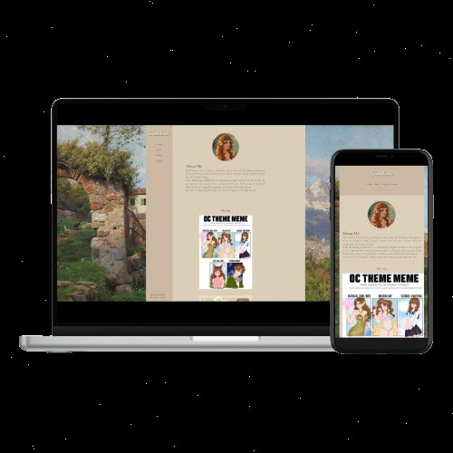

Sirendema - Artist Portfolio Website

Click here to visit the website: https://irbala.github.io/sirendema/

  

Click a screenshot to open the live site.

Description:

This is a creative and visually stunning portfolio website designed for Sirendema , a talented artist looking to showcase her work to a wider audience. 
The website serves as an online gallery, allowing visitors to explore her art, learn about her creative process, and connect with her for collaborations or commissions.

Built using HTML , CSS , and JavaScript , this project highlights my ability to create engaging, responsive, and visually captivating web experiences tailored to the unique needs of artists and creatives. 
The design reflects Sirendema's artistic style, ensuring a seamless blend of aesthetics and functionality.

Through this project, I demonstrate expertise in:

- Designing visually appealing layouts that reflect the client’s artistic identity
- Creating intuitive navigation for showcasing artwork effectively
- Ensuring a responsive and accessible experience across all devices

Key Features:

- Elegant and modern design tailored to an artist's portfolio
- Easy-to-navigate gallery to showcase artwork
- Responsive layout optimized for desktops, tablets, and mobile devices
- Contact information for inquiries and collaborations

Feel free to explore the code or suggest improvements—I’m always open to feedback!

Tech Stack: HTML, CSS, JS

## Design Decisions

- **Colours taken from the art.** Soft sand and parchment tones with a dusty rose accent sit quietly behind Deema's vintage-style illustrations instead of competing with them. <!-- guess: Fay, please confirm or edit -->
- **Storybook typography.** Waterfall, a flowing script, for titles and Cormorant Garamond for text give the site a hand-lettered, fairytale feel that suits the artwork. <!-- guess: Fay, please confirm or edit -->
- **A cover page first.** The site opens on a single illustration and a "Visit my page" button, like the cover of a book, before the gallery. <!-- guess: Fay, please confirm or edit -->
- **Fixed sidebar menu** on desktop so About, Gallery and Contact are always one click away while scrolling through the art.
- **Gallery from her own posts.** Gallery images come from the artist's posts on X, so the work shown is the work she has shared publicly.

## Accessibility

Checked on 19 November 2026 with [axe-core](https://github.com/dequelabs/axe-core) 4.10, the engine behind Lighthouse's accessibility score, against WCAG 2.1 A and AA plus axe's best-practice rules. Every page was tested in a desktop browser.

| Page | Issues | Rules passed |
|---|---|---|
| `home.html` | ✅ 0 issues | 34 |
| `index.html` | ✅ 0 issues | 20 |

Fixed in this round:

- Darkened the sidebar menu links and the contact links so they pass 4.5:1 contrast.
- Added a tighter shadow under the sidebar title so the light script stays readable on the sand background.
- Wrapped the cover page in `<main>` and marked the sidebar as the page banner, so screen reader users can jump between areas.
